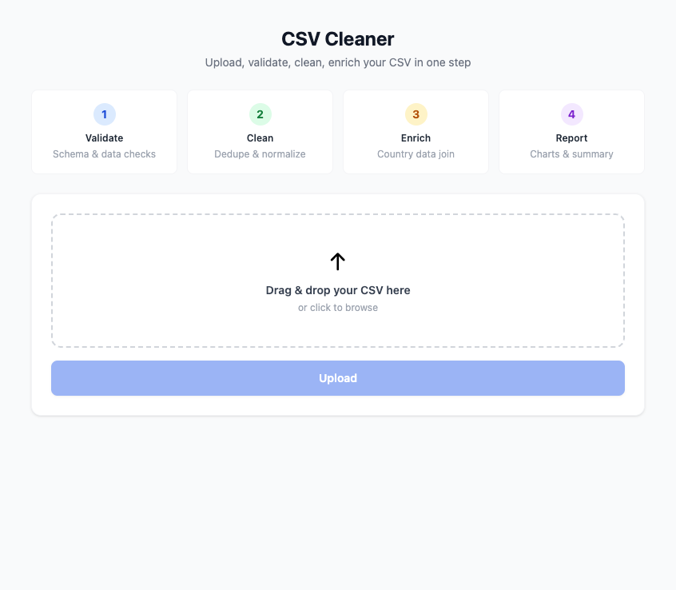
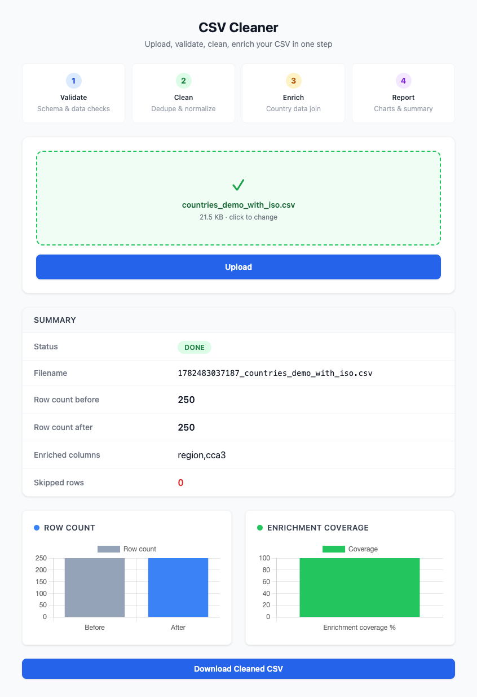
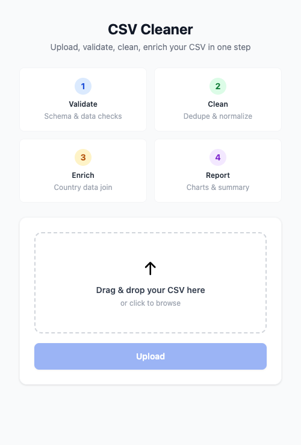
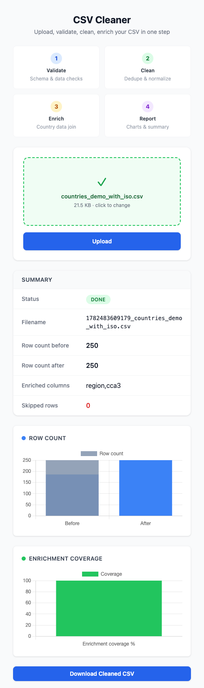

<!--
  Marp template — "product-demo"
  Copy into your repo (e.g. slides/intro.md), replace content.
  Render:  marp slides/intro.md -o slides.html   (or .pdf / .png)
  Screenshot-forward — built to show the product, not talk about it.
-->

---

marp: true
paginate: true
size: 16:9

---

<style>
@import url('https://fonts.googleapis.com/css2?family=Inter:wght@400;600;800&family=JetBrains+Mono:wght@500&display=swap');
:root { --bg:#f8fafc; --ink:#0f172a; --muted:#64748b; --accent:#0d9488; --line:#e2e8f0; --code:#0f172a; }
section {
  background:var(--bg); color:var(--ink);
  font-family:'Inter','Noto Sans','Pyidaungsu',sans-serif;
  font-size:26px; line-height:1.5; padding:48px 64px;
}
h1 { color:var(--ink); font-weight:800; font-size:1.6em; }
h2 { color:var(--accent); font-weight:600; }
h3 { color:var(--muted); font-weight:600; }
strong { color:var(--accent); }
a { color:var(--accent); text-decoration:none; }
img { border-radius:12px; box-shadow:0 12px 30px rgba(15,23,42,.18); }
code { background:#e6fffb; color:#0f766e; padding:.06em .35em; border-radius:5px; font-family:'JetBrains Mono',monospace; }
pre  { background:var(--code); border-radius:10px; }
pre code { background:none; color:#e2e8f0; }
blockquote { border-left:4px solid var(--accent); background:#ecfeff; color:#155e75; padding:.5em 1em; }
header,footer,section::after { color:var(--muted); font-size:.5em; }
section.cover {
  background:radial-gradient(800px 360px at 82% 14%, rgba(13,148,136,.18), transparent 60%), var(--bg);
}
section.cover h1 { font-size:2.3em; }
section.cover h2 { color:var(--muted); font-weight:400; }
section.shot { background:#0f172a; color:#e2e8f0; padding:0; display:flex; align-items:center; justify-content:center; }
section.shot img { box-shadow:0 20px 50px rgba(0,0,0,.5); border-radius:8px; max-width:88%; max-height:82%; }
</style>

<!-- _class: cover -->

# CSV Cleaner

## CSV Cleaner, browser-based tool that takes a messy CSV file and gives you back a cleaned-up version

Thuzar · @thuzarthaungsein · vibecode.tours

---

# What you get

- **Upload any CSV** — no fixed schema, works with any column structure
- **Instant clean report** — duplicates dropped, nulls flagged, dirty columns identified with sample values
- **Country enrichment** — rows with a country column get region and ISO data joined automatically
- **Download cleaned CSV** — get the fixed file with a full before/after summary

---

# What it does

- **Upload** CSV files with drag & drop
- **Detect** missing values, duplicates, invalid formats, and inconsistent data
- **Download** a cleaned CSV and a detailed validation report

---

<!-- _class: shot -->

- **Resolution used:** 1280×800 desktop





- **Resolution used:** 390×844 mobile





---

# How it's built

```bash
npm install && docker compose up -d && npm run dev
```

Stack: **Hono · TypeScript · DuckDB · PostgreSQL · Chart.js · Tailwind** · built with Claude Code

---

# Try it

- **Live:** https://csv-cleaner-qrqn.onrender.com/
- **Repo:** https://github.com/thuzarthaungsein/csv-cleaner
- **License:** MIT
